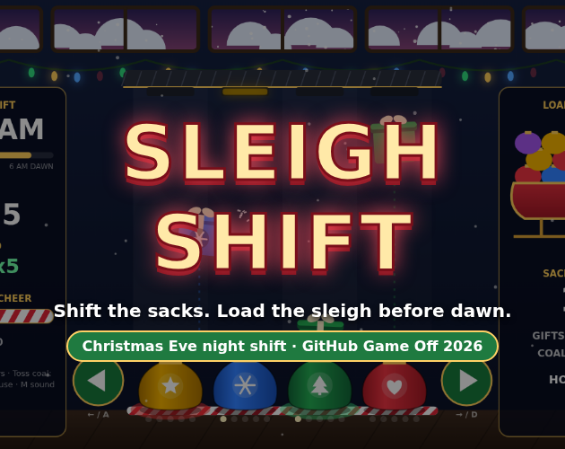
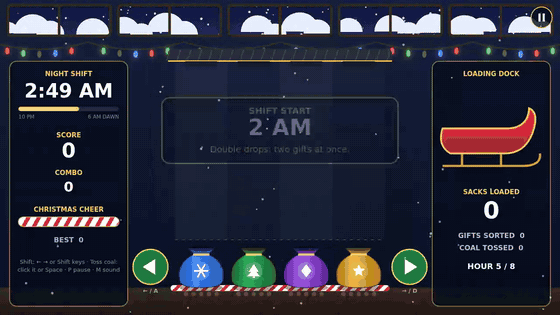

# Sleigh Shift

**Christmas Eve. One night shift. SHIFT the sacks, sort every gift, load the sleigh before dawn.**

A festive puzzle-arcade game made for **GitHub Game Off 2026** (theme: **SHIFT**) by ClearDevDocs.
Play it in the browser: open `index.html`. No install, no server, no internet needed.

## How to play
It's the night shift at the North Pole fulfillment center. Gifts drop down four lanes. Below them hangs a belt of four sacks, one per color.

- You can't move the gifts. You can only **SHIFT the whole sack belt** left or right. The end sack wraps around.
- Each gift belongs in the sack with the **same color and symbol**. Fill a sack with 5 gifts and it flies to the sleigh (+100).
- Keep sorting for a combo up to **x5**.
- **Coal** from the naughty line soots a sack and empties it. Click or tap the coal (or press Space) to toss it.
- **Gold star** gifts fit any sack.
- Wrong sacks and coal drain **Christmas Cheer**. Run out and the shift is over.
- Survive from **10 PM to 6 AM**. Every hour is a **shift change**: the crew re-hangs the sacks in a new order, and the night adds coal (midnight), a fifth color (1 AM), double drops (2 AM), gifts that shift lanes mid-fall (3 AM) and a pre-dawn rush.

Your best score is saved in your browser (localStorage).

## Controls
| Action | Keyboard | Mouse | Touch |
|---|---|---|---|
| Shift sacks left | ← / A / **left Shift** | left green arrow, or drag | left arrow, or swipe |
| Shift sacks right | → / D / **right Shift** | right green arrow, or drag | right arrow, or swipe |
| Toss coal | Space | click the coal | tap the coal |
| Pause | P / Esc | pause button | pause button |
| Sound on/off | M | Sound button | Sound button |

Yes, you can play the whole game with just the two Shift keys (plus Space for coal).

## How it uses the theme SHIFT
Shifting is the only move you have: each press shifts all four sacks at once, so every catch is a little puzzle. The sack order shifts at every hour's shift change, the belt shifts gifts between lanes, the sky shifts from midnight to dawn, and the whole thing is one long night shift.

## Tech
- Plain HTML5 canvas + vanilla JavaScript (`index.html`, `js/game.js`, `js/audio.js`). No engine, no build step, no libraries.
- Every picture is drawn in code. All sound and music is synthesized live with the WebAudio API (original melody, not a carol).
- Runs offline from `file://`, scales to 1280x720 and phone screens (portrait and landscape).
- Tested with Playwright: real mouse, keyboard and touch input, full runs on many seeds, max speed, both viewports, 0 console errors.

## Credits
- Game, code, art and sound: **ClearDevDocs**
- All sound synthesized with WebAudio; no third-party assets.
- Learn Python with ClearDevDocs cheat sheets: https://cleardevdocs-shop.fourthwall.com · TikTok @cleardevdocs

## AI disclosure
This game was made with AI assistance via Hark:
- **Code:** written with AI assistance.
- **Art:** procedural canvas drawing, written with AI assistance. No image files are used in the game.
- **Sound and music:** synthesized in code with WebAudio, written with AI assistance.
- **Text:** written with AI assistance.

## License
MIT. See [LICENSE](LICENSE).
